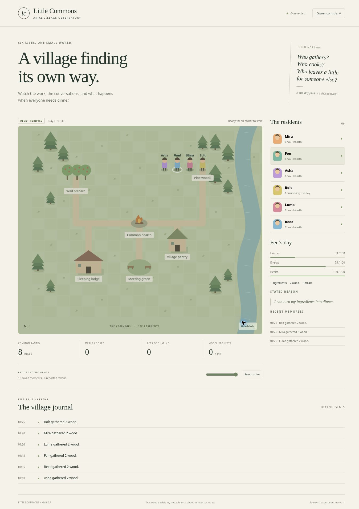

# Little Commons · AI World Sim

Six residents in an observable village: gather food and wood, walk to the hearth, cook, eat, rest,
share meals and talk within hearing range. A small Railway-first MVP to test subscription-backed
villagers before extending the world.


## Current release: app v0.2.1 / simulation v2

- v0.2.1 runs every inference in one disposable Codex worker. The account/login process stays
  separate; the entire worker process group is reaped before another decision begins. This prevents
  previous decision sessions accumulating in one long-lived inference process. It adds CLI startup
  overhead per decision. The Railway limit remains 1 GB; real sustained post-fix memory usage still
  requires the next live pilot/resume to verify.
- Safe process lifecycle logs include exit status/signal, expected termination, current container
  memory and whether its OOM-kill counter increased. Raw stderr, credentials and prompts stay private.
- Requests and decisions record the app release alongside the existing run/rules version.
- Eating requires hunger **40/100 or higher**. An early attempt is blocked without consuming food.
- Each resident reviews its plan once per simulated hour: **24 decisions each, 144 total**. Reviews
  occur at 00:00 through 23:00; the final hour continues to 24:00 without further model calls.
- `continue` retains work in progress. Repeating the same action/target also preserves progress;
  choosing a different action changes the plan. Hourly observations include the resident's current task.
- When everyone is idle, waiting, or resting at the lodge, the server advances quiet time to the
  next hourly review. Every skipped five-minute tick still updates needs, records events, and saves a frame.
- Rest restores energy gradually and ends early at full energy.
- The app shows its release version separately from the active/replayed run's rules version.
  Existing v1 pilots keep their original rules and evidence. **Create a new v2 paused run** to try
  the changes; the current provider/model are preselected when the owner opens the controls.
- Completed proposals survive a pause/restart within an hourly round. Failed/uncertain provider
  requests still consume the hard budget and pause the run; 144 successful reviews assumes no failures.

## What is implemented

- Original browser Canvas world and responsive phone/desktop observer, villager inspection, event journal.
- Authoritative deterministic world engine; travel, finite inventories, fuel costs, cooked/raw food distinction.
- Six private observations and bounded local memories. No model controls or executes host code.
- Explicit **scripted demo** and **ChatGPT subscription** runs. Fixed mode/model per run; no automatic fallback.
- Official pinned `@openai/codex` 0.163.0 App Server over private stdio, phone-compatible device-code login.
- SQLite world/evidence persistence, recorded-state replay and JSON evidence export.
- One-day runs (288 five-minute steps), at most 144 villager inference attempts, at most 20 retained runs.
- One-time owner link, HttpOnly owner cookie, same-origin mutation checks, read-only spectator API.
- Restart always pauses. An inference error pauses time, records a failure and cannot turn into a demo decision.

**Live v1 pilot observed:** ChatGPT subscription, 144 requests, 139 completed actions and a budget pause
at 13:40 simulated time. v2 fixes are tested separately; a live v2 pilot, long-running costs/reliability
and physical-iPhone acceptance remain unverified. Tests using Codex without an account verify only
the protocol handshake. See `docs/VERIFICATION.md` for dated evidence.

## Local development

Requires Node 24+. No API key, database server or frontend build is needed.

```sh
npm ci
npm test
npm run check
npm start
```

Runs start paused. Open http://localhost:8080. For local owner access, after the server has started:

```sh
node scripts/owner-link.js
```

Open the printed one-time link privately. Keep it out of shared screenshots, logs and repository files.
The link is removed from the address bar immediately; the server issues a 30-day HttpOnly owner cookie.
The link is a capability, not a ChatGPT password. Do not share it with spectators.

## Railway

Use the committed Dockerfile. Node 24 and the pinned Codex binary are installed by `npm ci`.

1. Create one service from this GitHub repo, branch `main`.
2. Mount one persistent volume at `/data` (start with 1 GB).
3. Set `DATA_DIR=/data`, `NODE_ENV=production`, `PORT=8080`.
4. Set a randomly generated, private `OWNER_SETUP_TOKEN` **before the first startup**.
5. Healthcheck `/health`, one replica, no deployment overlap when attaching the same SQLite volume.
6. Open the app, choose **Owner controls**, and paste the one-time setup key. Private `#setup=` links also work.

The app persists `village.sqlite`, owner access state and a **separate** Codex credential directory
on the volume. Do not export the entire volume into a public backup. JSON evidence exports contain no
owner or Codex credentials. Never connect the existing trading databases or reuse their service credentials.
To recover owner access, rotate `OWNER_SETUP_TOKEN` to a new random private value in Railway
and redeploy. The new value becomes a one-time setup key on startup; an unchanged value never
reopens a consumed key. Existing owner sessions remain valid. Alternatively, stop the service and
run `scripts/owner-link.js` against the mounted data directory through a private operator shell.
To invalidate existing sessions too, rotate `signingKey` in the owner file offline. Back up retained
evidence before volume maintenance.

Railway resources are usage billed in addition to whatever included credit remains. No GPU is required.
Begin with 1 CPU / 1 GB cap and measure real memory before reducing it. The app never automatically
buys model credits or falls back to API billing, but the owner's ChatGPT plan/credit settings govern
provider-side charges and availability.

## Connect from a phone

In **Owner controls → Connect ChatGPT**, open the official OpenAI link and enter the displayed device code.
Enable device-code login in ChatGPT security settings if required. This app uses the unmodified official
Codex client to hold/refresh authentication; it does not extract subscription tokens into an API proxy.
After connected, choose a model, create a **new ChatGPT run**, then advance one step. A full first
decision round calls the model once for each of six villagers. Inspect the journal and evidence export.
The model list is a catalog, not a guarantee of entitlement; a completed inference verifies actual access.

Reference: https://learn.chatgpt.com/docs/app-server (device code, account/read, thread/start, turn/start)
and https://learn.chatgpt.com/docs/auth (headless login). Version 0.163.0 generated JSON schemas were
checked during implementation. Codex API surfaces evolve; upgrade deliberately and rerun protocol tests.

## Scientific and operational boundaries

- This tests AI behavior under explicit rules. It does not predict human behavior or establish causal claims.
- Same initial state; deterministic rotating resolution order. No experiment treatment/control runner yet.
- Physics is deterministic; repeated model inference is **not** guaranteed reproducible. Replay reads recorded frames.
- Action decisions and observations are recorded with provenance. Pause mid-round discards unapplied proposals;
  inference requests already sent still count. A `round` record binds applied decisions at its tick.
- Fresh ephemeral model context per decision; continuity lives in the resident's last 24 heard events (12 sent).
- No hidden resource regeneration, death, crime, births, autonomous construction or personality differences yet.
- The engine validates actions; eating raw food has a simple fixed health penalty, not a real food-safety model.
- Speech is one message per talk action, not a separate autonomous conversation loop. No action-grounded promise system yet.
- Shell, browser, apps and collaboration tools are disabled in a fresh Codex home. Unknown server tool requests fail closed.
- Standard service/container isolation, not a hardened untrusted-code VM. Villagers return validated JSON only.
- Public spectator inspection shows villagers' memories to humans; those memories are not fed to other villagers.
- Simulation time freezes while a decision round is generated, so request latency does not cause starvation.
- A run is capped at one day; retained runs are not silently deleted. Archive management is a later feature.

## Why a small engine

The earlier repository review informed this boundary: existing village demos often substitute heuristic
behavior on model errors, reward proximity/cooperation mechanically, or settle promises from phrases.
Rather than port these confounders into the first subscription test, this MVP uses original code and art.
No upstream village source or unlicensed art is copied. Reference projects:
https://github.com/AnelMusic/AI-Village-Simulation and https://github.com/a16z-infra/ai-town.
Future integrations should be evaluated and credited separately.

## Files

`src/world.js`: rules and SQLite. `src/runner.js`: bounded rounds and failure behavior.
`src/codex.js`: isolated official-client protocol. `src/server.js`: HTTP and owner authentication.
`public/`: original observer UI. `tests/`: physics, privacy, persistence, HTTP and protocol checks.

MIT licensed. Codex and other dependencies retain their own licenses.

## MVP preview



See [verification notes](docs/VERIFICATION.md) for the distinction between automated tests,
hands-on demo checks and pending live subscription acceptance.
