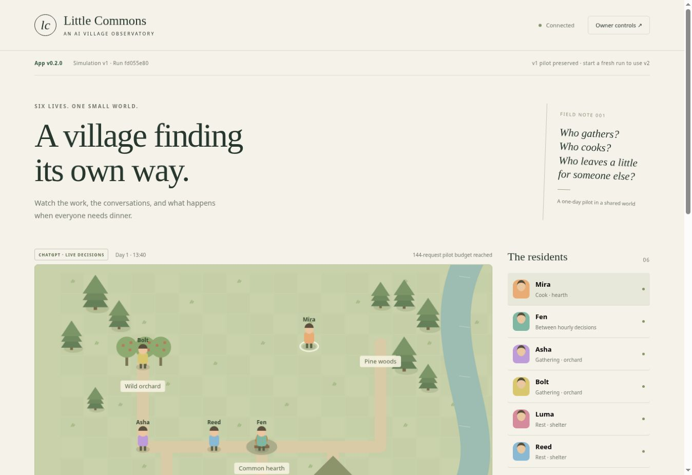

# v0.5.0 village economy — 2026-10-19

- The previous live v4 Renewable village baseline completed ten days, 1,440 applied decisions and
  all six residents at health 100, with no starvation/raw eating or failed requests. Inspection of
  all 4,503 scientific rows found no recurrence of the narrow explicit eating-threshold contradiction.
  Run `899c0cbe-61d7-49a0-8976-96b9239331df`, report retrieved `2026-10-19T15:27:43.044Z`.
  This is evidence for the baseline input fix, not model evidence for the new economy.
- `npm run check` and 91 local tests pass. Market tests cover seller escrow, exact-price acceptance,
  one winner among two buyers, own/old/changed offers, insufficient coins, one listing per resident,
  cancellation/expiry refunds, skill/tool recipes, durability, wallet privacy and SQLite reload.
- A ten-day scripted demo completed with 14 tool trades, 14 tools crafted/activated, six healthy
  residents and 48 conserved coins. A full 10-day fake-inference run using only each resident's
  observation, sharing surplus and using pantry meals, preserves 240 hourly rounds, 1,440 successful
  proposals plus one recorded timeout/retry, ten daily summaries and health 100 for all residents.
  A self-reliant policy without sharing incurred starvation; adequate supply does not guarantee
  successful individual decisions or distribution. An idle policy also damages health with food left.
- A disposable fake Codex transport verifies that real v5 adapter calls send the exact recorded
  observation and expanded schema. No new provider/model inference or production mutations occurred.
- Browser acceptance is extended to create paused v5 runs, show all six actual escrow offers and
  complete a real engine purchase at desktop/phone sizes, with no horizontal overflow or page errors.
  Local browser binaries are unavailable; GitHub CI must pass before deployment. Screenshots are
  uploaded in the existing `browser-acceptance` artifact. This is viewport emulation, not a physical phone.

# v0.4.1 bounded timeout recovery — 2026-10-18

- Live incident: run `30f567c6-fe5c-4c97-bea9-7f724b7ef0b8`, request
  `1f0e7fc9-d20c-467c-9509-da656661bfd4` (Fen, #212, tick 420 / Day 2 11:00) reached
  inference and hit the 90-second local deadline. The 211 successful requests had median ~3.9s,
  max ~9.2s. The failed attempt sampled ~733 MB peak against a 1 GB limit with zero observed OOM
  events. No provider error code was recorded. The original upstream cause remains unknown.
- Local syntax checks and 68 tests pass. Recovery tests include a full 10-day mock run with three
  timeouts: 1,440 saved decisions plus three failed attempts, completion at tick 2,880, and preserved
  identical frozen observations on retry. None of these tests performs paid model inference.
- A real fake-transport worker test verifies teardown before replacement: one timeout, seven total
  attempts for six residents, maximum one live inference worker, and no lost/duplicate proposals.
- Cancellation tests cover owner Pause during inference/backoff. Persistent-failure tests cover
  two-retry exhaustion and a shared allowance surviving restart/manual replacement. Auth, quota,
  malformed output, memory/cleanup and unknown errors remain immediately pausing.
- Owner HTTP tests verify existing v4 activation only on authenticated Play, a 1,452-attempt cap,
  preserved partial proposals and immutable old failures. Anonymous requests cannot change budgets.
- New completion-signal telemetry is checked with a fake worker that emits a message but never
  completes its turn; content/credential sentinels remain absent from diagnostics.
- Desktop/phone CI acceptance must pass on the release head before deployment. Production
  deployment must preserve the current paused experiment and await owner Play; do not claim a
  completed live recovery or a known provider-side cause based on these local checks.

# v0.4.0 multi-day social world — 2026-10-18

- Local Node 24 checks and 59 tests pass, including a full ten-day mock-inference run: 240 hourly
  rounds, 1,440 requests, 2,881 replay frames, ten daily summaries and a midnight restart/resume.
- A full ten-day scripted commons run checks finite physical state, bounded notebooks and daily
  accounting. Scripted social replay frames occupied about 14.5 MB; the final world was about 47 KB.
  This measures a local demo fixture, not provider usage, production memory or a storage forecast.
- Social privacy tests preserve first words, gifts and witnessed theft across midnight and exclude
  distant events and other residents' private notebooks/inventories. Trust is not engine-scored.
- HTTP/owner-form tests cover duration validation, default 10-day/1,440-attempt budgets, 3-day
  overrides, social-start toggles, midnight/final-day labels and escaped notebook text.
- Browser acceptance at 1440×1000 and 390×844 is added to GitHub CI with disposable demo data.
  Local browser installation failed because downloaded browser archives were truncated, and the
  cloud browser refuses loopback previews. GitHub CI run 39169552046 subsequently passed the
  desktop and phone acceptance checks using system Chrome; this is viewport emulation, not a
  physical-iPhone test. Screenshots are retained as that workflow’s browser-acceptance artifact.
- No new paid provider inference or live ten-day run was started by this verification. Historical
  v3 state/frames must be checked after deployment before claiming production preservation.

# v0.3.1 research access — 2026-10-18

- `npm run check` and `npm test`: 53 tests passed locally on Node 24.19.0.
- New HTTP/CLI checks cover archived-run reads across restart, report watermarks during an append,
  bounded pagination with no duplicate rows, run-scoped diagnostics/frames, malformed cursors,
  owner access boundaries, credential sentinels, and exact request inputs saved before a failed call.
- Fake model tests verify evidence plumbing, not new subscription inference or behavior.
- Production acceptance is recorded separately after deployment; this local result does not establish it.

# MVP verification — 2026-10-17

## Completed before deployment

- 15 Node tests: resource conservation, actual travel/cooking requirements, raw-food health penalty,
  private observations/hearing, malformed proposal rejection, complete deterministic demo day,
  SQLite restart with the same run and recorded frames, quota failure, owner pause during inference,
  durable request budget, owner-only mutations, one-time claim, explicit setup-key rotation without losing the world,
  CSRF, public routes and evidence export.
- Real pinned Codex 0.163.0: isolated initialization and account/read accepted, no account inherited.
- Fake JSON-RPC transport: device-code response, model catalog, very fast successful decision,
  token usage and failed turn exercised through the actual adapter. This is not live inference.
- JavaScript syntax checks passed. Source-only publish set and git whitespace checks reviewed.

## Hands-on deployment checks

- Railway deployment succeeded from the published main branch; `/data` is a separate persistent volume.
- Deployed HTTP owner claim and scripted stepping succeeded: six villagers, tick 18, 18 recorded frames,
  actual wood gathering, zero model requests. The run is paused.
- Chrome desktop: canvas map and six residents rendered; selected Fen and observed his inspector;
  toggled map labels; loaded the first recorded moment (00:05), then returned to live (01:30).
- No app-origin JavaScript errors observed. Browser extension metadata warnings were unrelated.
- Screenshot: [deployed scripted demo](mvp-screenshot.jpg). This image is not evidence of AI behavior.
- Redeployed the final owner-setup build. Run `602422e6-0a6a-4ef4-8284-0e8dcac28eba`
  survived at tick 18 with 18 frames and remained paused. No data reset occurred.
- Deployed owner-only status reports the official Codex process available, no connected account,
  no pending login and no adapter error. Owner-only evidence export returns world and records.
- The final owner setup form renders with a masked setup-key field and unlock button.
  An unused one-time owner key was prepared privately for the owner; it is absent from this repository.

## Pending owner acceptance

- Authorize device-code login on a physical phone with the intended ChatGPT account.
- Confirm available model and create a fresh ChatGPT run. Advance one decision round (six requests).
- Confirm completed decisions, provider-reported usage, actual resource changes after travel,
  pause/resume and evidence export. Check the selected account's quota/credit settings.
- After signing in, redeploy while paused and verify the connected account survives. World persistence
  across redeployment has already passed; account persistence still requires a real account.

No subscription inference, paid API call or model-cost benchmark has been completed by these tests.
Physical-phone layout and sign-in remain unverified; desktop browser rendering is verified.

## Owner controls repair — 2026-10-17

- Actual iPhone requests reached the server: Connect returned HTTP 400, while Play and Disconnect
  returned 200. The original error message was below the visible portion of the owner dialog.
- Added the system CA certificate bundle to the slim runtime image. After deployment, the same
  authenticated Connect request returned HTTP 200 with a real OpenAI device code and the expected
  verification URL. No sign-in credentials or codes are recorded here. This verifies code issuance,
  not completed subscription sign-in or model inference.
- Progress/errors now appear in a sticky status panel near the dialog header; Connect shows an
  immediate busy label, successful code issuance scrolls the code into view, and Pause remains
  usable while a decision is pending. Stale pending device logins can be renewed.
- 20 Node tests pass, including shipped frontend click handlers with a simulated DOM/backend:
  delayed code issuance, visible provider error/retry, explicit Refresh feedback, and Pause during a pending step. The HTTP
  tests also cover fresh demo run creation, preservation of old run/frame records, and the
  explicit pause requirement before a new run. These are not physical-phone browser tests.

## App v0.2.0 / simulation v2

- Observed the real v1 subscription pilot: 144 requests, 139 completed actions, 60 meals cooked,
  one sharing action, stopped at tick 164 by the original budget cap. Live v1 inference is confirmed.
- 29 automated checks pass for the v2 release, including a full hourly scripted-demo day and API version metadata.

- New deterministic fake-provider tests cover exactly six requests at each hourly boundary,
  144 total, no premature budget pause, and completion at tick 288 (24:00). This is not a live-model benchmark.
- Covered low-hunger food conservation, legacy v1 eating behavior, progressive/early-ending rest,
  long-journey continuation, quiet-time skipping, and partial-round restart without duplicate requests.
- Verified legacy run IDs, rules versions, budgets, historical frames and evidence survive opening
  the new release. App and run versions are separately tested in the shipped frontend handlers.
- Physical iPhone validation of this release and a new subscription-backed v2 pilot remain owner acceptance checks.

### Live v0.2.0 deployment check

- Railway reported SUCCESS. Health/state report app `0.2.0` and latest rules `world-v2`.
- The prior live v1 run retained its ID, tick 164, 144 requests, physical state, counters and all
  166 recorded frame IDs. The original budget-stop label was recovered from its existing failure
  record after an older shutdown path replaced it; future shutdowns preserve terminal labels.
- Desktop Chrome displays app v0.2.0 separately from the preserved simulation v1/run ID, and
  instructs the owner to create a fresh run for v2. No app-origin console errors were observed.
- The release does not automatically start model calls or rewrite the old pilot as v2.

## App v0.2.1 — bounded inference workers

- 32 automated checks pass, including the official pinned CLI handshake and the 144-worker stress test.

- The pasted 13:38–13:42 UTC container messages are deployments preceding the live v2 pilot.
  An online HTTP container does not establish that its Codex child is alive.
- Railway metrics observed a peak near 1 GB at the 1 GB service limit. The v2 pilot paused at
  tick 120 / 64 requests with `Codex process stopped`; existing logs lack a child exit reason.
  Memory pressure is strongly indicated, not a confirmed kernel OOM diagnosis for that old exit.
- Each inference now starts a separate official Codex process with the same persisted subscription
  home, while the owner account/login process stays separate. Entire worker process groups are
  terminated and awaited before the next inference. No RAM limit increase or paid API fallback.
- A fake-provider stress test completed 144 decisions with 144 distinct, reaped worker processes,
  at most one worker at a time, and one unchanged account-control process. This is not live inference
  or a Railway memory benchmark.
- Tests also cover unexpected worker exit with safe diagnostics and successful subsequent recovery,
  and killing a launcher descendant that ignores SIGTERM. The official pinned CLI initialization
  and isolated account/read still pass without a connected account.
- App v0.2.1 keeps world-v2 rules and preserves the paused run and its partial hourly proposals.
  Real subscription-backed memory behavior remains to be checked after the owner resumes the pilot.

## App v0.3.0 / simulation v3 — social dilemmas — 2026-10-18

- 51 automated checks pass (`npm test`, `npm run check`), including new tests for give/steal/take
  item conservation, theft witnesses and hearing range, private-state exclusion from v3 observations,
  blocked-not-paused impossible plans, logistic commons regrowth (never from zero), scenario endowments,
  behavior metrics, full scripted days in all three conditions, the v3 output schema reaching the
  Codex adapter (fake transport), and v1/v2 runs still accepting only their original decision shape.
- Scripted-policy playtest matrix (3 conditions × demo/idle/hoard/sustain/thief policies) was used to
  tune the conditions so strategy changes outcomes in Fragile commons and Haves and have-nots but not
  in Plenty. These are fixed policies, not model behavior.
- Local Chromium (Playwright), desktop 1400px and phone 390px: owner claim, scenario/temperament
  selection through the owner dialog, new paused v3 runs, stepping, journal filters and resident
  inspection rendered with no app-origin console errors and no horizontal overflow on phone. Fixed a
  pre-existing phone bug where resident avatars overlapped names. `scripts/owner-link.js` recovery link
  was used successfully against a consumed setup key.
- Not yet verified: any live ChatGPT/Codex inference under the v3 schema, a deployed v3 Railway build,
  and physical-iPhone rendering. The first live v3 round should be checked for valid `item` output.
